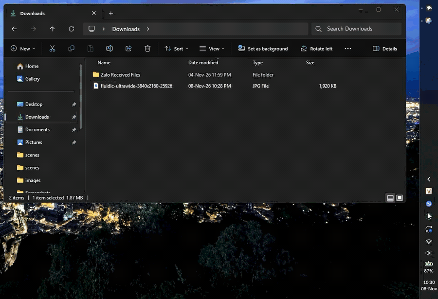

# LocalSend Flyout

A compact, tray-adjacent flyout for the official LocalSend Windows app, built as a [Windhawk](https://windhawk.net/) mod.

## What it does

- Opens LocalSend as a compact flyout from its tray icon.
- Keeps LocalSend's normal file selection, device discovery, receiver approval, and HTTPS/TLS transfer flow intact.
- Supports click-away dismissal, DPI-aware positioning, and configurable size and behavior.

## Install

1. Install [Windhawk](https://windhawk.net/).
2. In Windhawk, open **Explore** and search for **LocalSend Flyout** once the upstream submission is merged.
3. Until then, create a new mod in Windhawk and paste the contents of [src/localsend-flyout.wh.cpp](src/localsend-flyout.wh.cpp).

## Controls

- Left-click the LocalSend tray icon to show the flyout.
- Click it again, or click elsewhere, to hide it.
- Pick or drag files into LocalSend, then choose the receiving device as usual.

## Project structure

- `src/localsend-flyout.wh.cpp` — canonical Windhawk mod source.
- `assets/localsend-flyout-demo.gif` — demo recording.
- `LICENSE` — MIT License.

## Upstream status

The same source has been submitted to the official Windhawk collection in [ramensoftware/windhawk-mods#7136](https://github.com/ramensoftware/windhawk-mods/pull/7136). Updates should start in this repository, then the exact source file should be synchronized to `mods/localsend-flyout.wh.cpp` in the Windhawk contribution branch.

## Credit

Interaction design inspired by [Quick Share Flyout](https://windhawk.net/mods/quick-share-flyout) by [0Allu](https://github.com/0Allu). This is a separate LocalSend-specific implementation, created with vibecode; it does not copy the original mod blindly.
